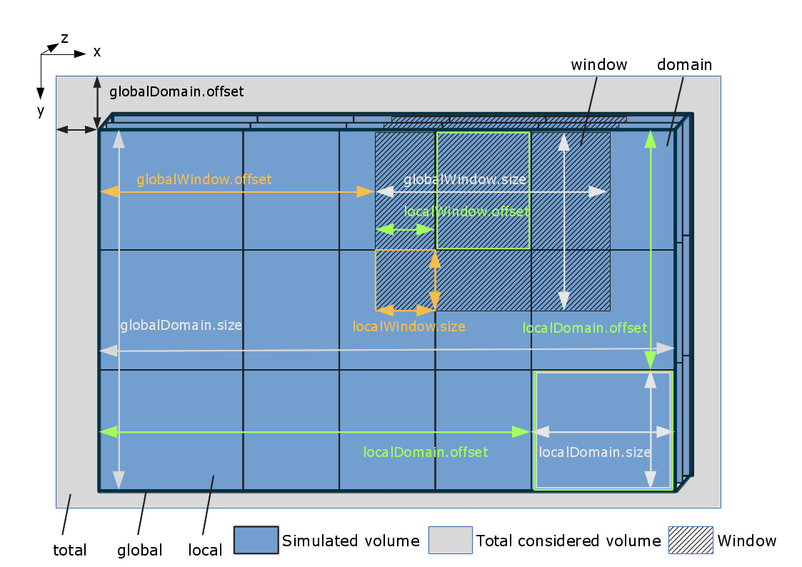
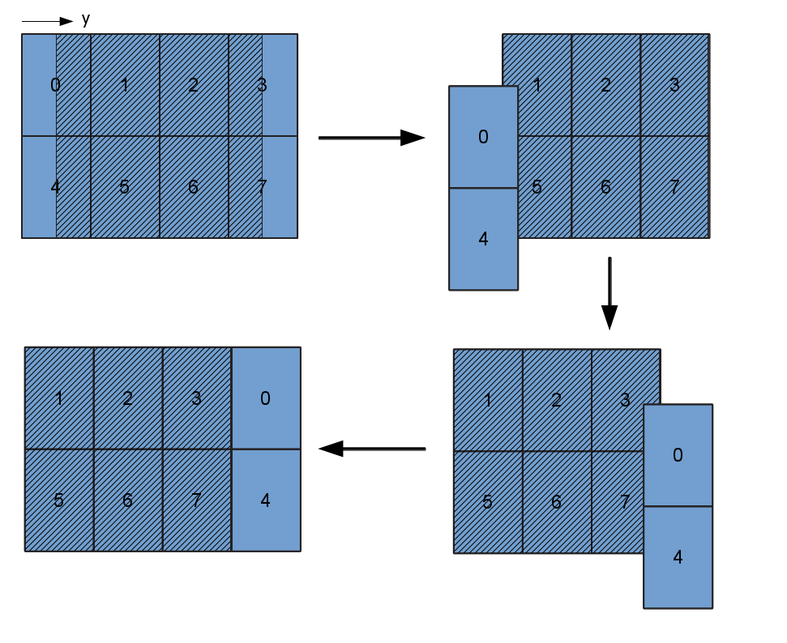
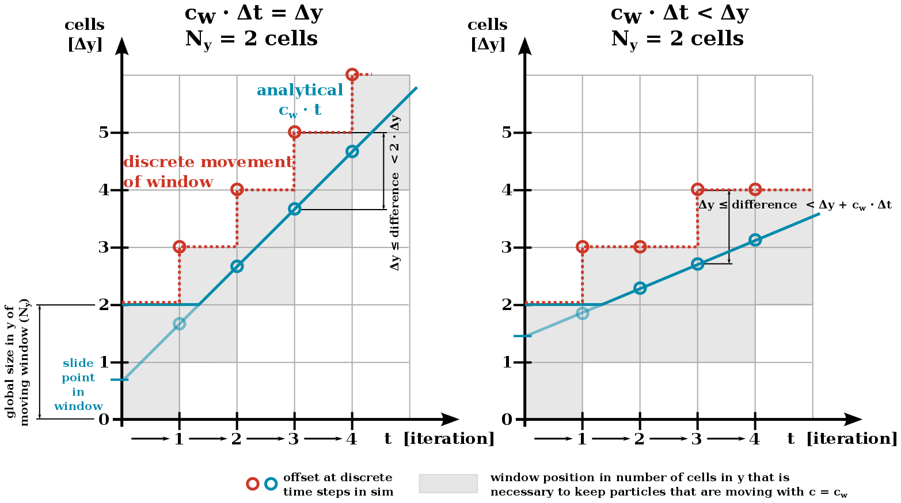

.. _usage-domain-definitions:

Domain Definitions
==================

.. note::

   This page was migrated from the `PIConGPU wiki <https://github.com/ComputationalRadiationPhysics/picongpu/wiki/PIConGPU-domain-definitions>`_.

PIConGPU describes grid-based quantities in **number of cells** and splits the simulation volume into
nested *selections*.
The following definitions apply to all plugins and to the internal API.

   Nested *domain* and *window* selections.

Selections
----------

- ``domain``: a contiguous volume on one or all GPUs
- ``window``: any part of a domain

Both are represented by ``pmacc::Selection<simDim>`` (see ``include/pmacc/mappings/simulation/Selection.hpp``),
which has two members:

.. list-table::
   :header-rows: 1

   * - member
     - type
     - meaning
   * - ``.size``
     - ``DataSpace``
     - size of the selection
   * - ``.offset``
     - ``DataSpace``
     - offset of the selection from its next higher hierarchy

Offsets are exclusive and always relative to *the element that is above the selection in the hierarchy*.

Naming Hierarchy
----------------

- ``local``: the object is located on the current ("my") GPU, without guards
- ``global``: the currently simulated volume over all GPUs, without guards
- ``total``: also takes parts into account that are not in the global volume any more, e.g. areas that
  have been left behind by the :ref:`moving window <usage-domain-definitions-moving-window>`

Resulting Semantics
-------------------

Global selections:

- ``globalDomain.size``: size of the currently simulated volume on all GPUs
- ``globalDomain.offset``: offset caused by slides, i.e. the offset of the global domain within the total domain
- ``globalWindow.size``: size of the current moving window, cutting away areas of the global domain
  that are before or after the window
- ``globalWindow.offset``: offset of the moving window from the first GPU, i.e. the offset of the window
  within the global domain

Local selections:

- ``localDomain.size``: size of my GPU's domain
- ``localDomain.offset``: beginning of my local domain *within* the global domain
- ``localWindow.size``: size of the moving window's volume on my GPU
- ``localWindow.offset``: offset of my part of the moving window from the start of the global window

Special cases:

- If my GPU is *not contained* in the moving window, ``localWindow.size`` is zero and
  ``localWindow.offset`` is undefined.
- An interface, for example a density profile, might need an *inclusive* domain offset such as
  ``localDomain.offset + globalDomain.offset``.
  A consistent name for this quantity is ``localDomainToTotal``.
  Note that, as defined above, ``localDomain`` alone means ``localDomainToGlobal``, because ``global``
  is the next higher hierarchy.

.. _usage-domain-definitions-moving-window:

Moving Window
-------------

PIConGPU uses a *moving window* when started with the ``-m`` command line parameter
(``TBG_movingWindow="-m"`` in ``docs/TBG_macros.cfg``).
It enables simulations that follow a laser pulse for an unlimited number of time steps while keeping a
fixed simulation grid size.
The moving window selects only a subvolume of the complete global domain for simulation: the moving
direction (``y``) is shortened by the ``y``-size of one GPU.

After a slide, the global domain offset is increased by the ``y``-size of one GPU while the global domain
size stays constant.
During the simulation, GPUs slide from the top to the bottom of the simulation grid as the moving window
progresses:

The moving window is implemented as a ``Window`` selection (see above).
Developers can choose to apply algorithms either to the volume covered by the moving window or to the
complete global domain:

- ``MovingWindow::getInstance().getWindow(currentStep)`` returns the window of the current moving window.
- ``MovingWindow::getInstance().getDomainAsWindow(currentStep)`` returns the window covering the complete
  global (and local) domain.

For simulations started without ``-m``, the moving window is always equivalent to the global domain.

Precision of the ``offset`` annotation
^^^^^^^^^^^^^^^^^^^^^^^^^^^^^^^^^^^^^^

For the description of the simulation domain, e.g. in output files, the ``offset`` is always a discrete
number of cells.
Since the cell size is for most solvers and setups at most :math:`c \cdot \Delta t`, the offset does not
increase continuously in every time step; it is propagated as discrete jumps.
This is the offset that, for example, the openPMD and PNG plugins write:

